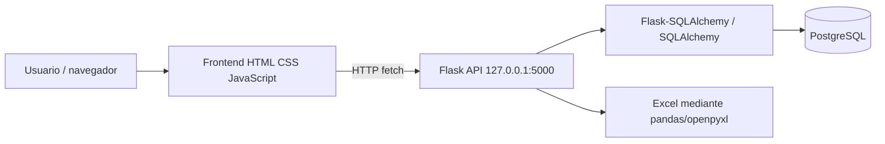

# Arquitectura

## Visión general



El frontend define la URL base en `frontend/js/api.js` y utiliza `fetch`. Flask habilita CORS globalmente mediante `CORS(app)`. SQLAlchemy construye la URL PostgreSQL desde variables de entorno.

## Capas y flujo

1. `backend/app.py` crea la aplicación, carga `Config`, inicializa CORS y SQLAlchemy y registra los blueprints.
2. `backend/routes/` recibe peticiones, valida parámetros, consulta modelos y serializa respuestas JSON.
3. `backend/models/` declara tablas y relaciones ORM.
4. `backend/routes/estudiantes.py` procesa Excel con pandas y utiliza openpyxl para lectura/escritura auxiliar.
5. El navegador presenta `frontend/paginas/`, reutiliza `frontend/components/` y consume `frontend/js/api.js`.

## Estructura relevante

```text
backend/
  app.py                 Arranque Flask, registro de blueprints y creación/ajuste de tablas
  config.py              Carga de .env y URI SQLAlchemy
  extensions.py          Instancia compartida de SQLAlchemy
  utils.py               Utilidades del backend
  requirements.txt       Dependencias fijadas
  models/                Modelos ORM
  routes/                Endpoints
frontend/
  index.html              Panel inicial
  components/             header, sidebar y footer
  css/                    Estilos por módulo
  js/                     Consumo API y lógica de interfaz
  paginas/                Vistas de carga, consultas, indicadores y módulos
  assets/                 Iconos e imágenes
```

Los archivos de rutas `docentes.py`, `egresados.py`, `titulados.py` y `administrativos.py` están presentes, pero `app.py` no los importa ni registra. Por tanto, su disponibilidad no está verificada como parte de la aplicación ejecutable.

## Decisiones técnicas y consideraciones

- **Autenticación y autorización:** No se identificó una capa de autenticación o autorización en el código revisado. Se requiere verificar este aspecto antes del despliegue en producción.

- **CORS:** La aplicación habilita CORS globalmente mediante `CORS(app)`. Para producción se recomienda restringir los orígenes autorizados.

- **URL del backend:** El frontend utiliza una dirección local (`127.0.0.1:5000`) definida en `frontend/js/api.js`. Para despliegues se deberá configurar la dirección correspondiente al servidor.

- **Inicialización de la base de datos:** Durante el arranque se ejecutan operaciones de creación o modificación del esquema. Se recomienda evaluar el uso de migraciones controladas mediante Flask-Migrate/Alembic.

- **Registro de módulos:** La existencia de archivos de rutas no garantiza su disponibilidad. Los Blueprints deben estar registrados en `app.py` para que sus endpoints formen parte de la aplicación.
