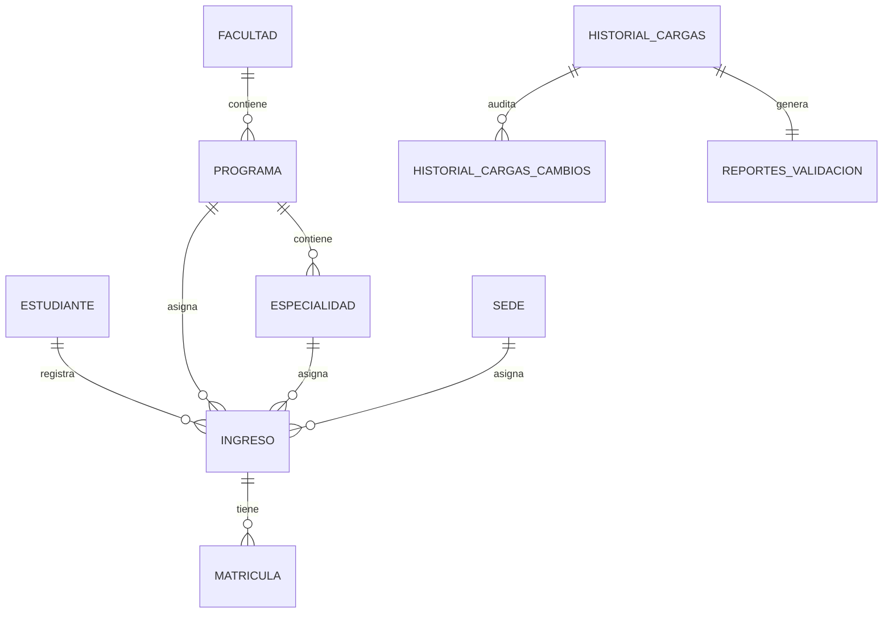

# Base de datos

## Motor y acceso

El código usa PostgreSQL mediante `postgresql+psycopg2`, SQLAlchemy y Flask-SQLAlchemy. Las tablas se crean con `db.create_all()`; no existe un directorio de migraciones versionadas.

## Tablas ORM

| Tabla | Clave primaria | Campos principales | Relaciones |
|---|---|---|---|
| `beca` | `id_beca` | `nomb_beca` | 1:N con `estudiante` |
| `colegio` | `id_colegio` | `colegio_procedencia`, `tipo_procedencia`, `nomb_colegio`, `distrito_colegio` | 1:N con `estudiante` |
| `discapacidad` | `id_discapacidad` | `tipo_discapacidad`, `discapacidad_si_no` | 1:N con `estudiante` |
| `movilidad` | `id_movilidad` | `nomb_movilidad` | 1:N con `estudiante` |
| `ubigeo` | `id_ubigeo` | `pais_nac`, `dep_nac`, `provincia_nac`, `distrito_nac` | 1:N con `estudiante` |
| `facultad` | `id_facultad` | `nomb_facultad` | 1:N con `programa` |
| `programa` | `id_prog` | `cod_prog`, `nombre_prog`, `id_facultad` | N:1 facultad; 1:N especialidad e ingreso |
| `especialidad` | `id_especialidad` | `codigo_especialidad`, `nomb_especialidad`, `id_prog` | N:1 programa; 1:N ingreso |
| `sede` | `id_sede` | `nomb_sede` | 1:N local e ingreso |
| `local` | `id_local` | `nomb_local`, `id_sede` | N:1 sede |
| `estudiante` | `id_codigo_alumno` | identidad, contacto, domicilio y `id_colegio`, `id_movilidad`, `id_beca`, `id_discapacidad`, `id_ubigeo` | 1:N ingreso |
| `ingreso` | `id_ingreso` | `tipo_preparacion`, `modalidad_ingreso`, `periodo_ingreso`, `id_codigo_alumno`, `id_prog`, `id_especialidad`, `id_sede` | N:1 estudiante/programa/especialidad/sede; 1:N matrícula |
| `matricula` | `id_matricula` | periodo, régimen, ciclo, créditos, promedio, ranking, `id_ingreso` | N:1 ingreso |
| `historial_cargas` | `id_carga` | archivo, fecha, filas, procesados, inconsistencias, estado, observaciones, `archivo_contenido` | 1:N cambios; 1:1 reporte |
| `historial_cargas_cambios` | `id_cambio` | carga, tabla, clave, operación, snapshots JSON | N:1 historial |
| `reportes_validacion` | `id_reporte` | carga, archivo, huella, filas, inconsistencias, resúmenes JSON, estado | 1:1 historial |
| `correcciones_reportes` | `id_correccion` | carga, archivo, huella, campo, valor, motivo | N:1 historial |
| `auditoria_correcciones` | `id_auditoria` | tabla, registro, campo, anterior, nuevo, motivo, usuario, fecha | Registro independiente |
| `documentos_pendientes` | `id_documento` | alumno, tipo, descripción, responsable, estado, fecha límite | Sin FK declarada |

`app.py` añade columnas con `ALTER TABLE IF NOT EXISTS`, entre ellas `correcciones_pendientes`, `huella_archivo`, `archivo_contenido`, `id_carga` y `estado`. Los tipos y nulabilidad exactos son los declarados en los modelos y esas sentencias.
